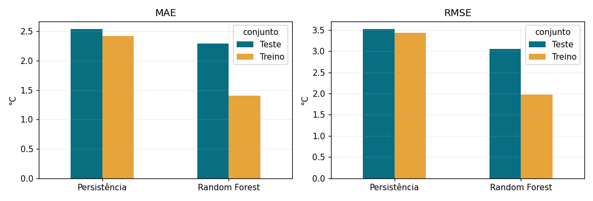
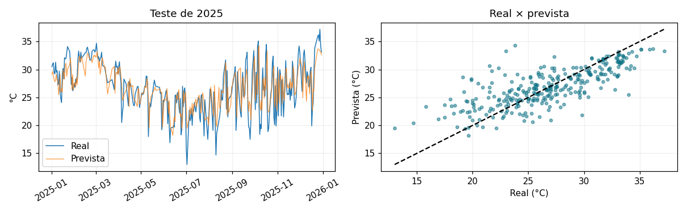

# Refresca SP — Relatório de Machine Learning
**Equipe:** Matheus — RM 555177; Gustavo A. — RM 559098; Nicolas — RM 556617; Gustavo C. — RM 556289; Igor Soos — RM 556010. **Execução UTC:** 2026-11-06.

## Problema, dados e pergunta
O Refresca SP propõe apoiar idosos e trabalhadores de rua com informação sobre dias muito quentes.
Pergunta: observações até o fim de D permitem prever a máxima de D+1 na estação A701, São Paulo — Mirante?
O experimento é isolado, sem integração com APIs ou app. Usamos CSVs horários públicos do
[INMET](https://portal.inmet.gov.br/dadoshistoricos), anos 2021–2025; URLs, arquivos e hashes estão
em `resultados/manifesto_fontes.json`. A estação representa seu entorno, não toda a cidade.

## Preparação e modelo
Interpretamos vírgula decimal, ausências e sentinelas, removemos duplicatas idênticas e marcamos
valores fora de limites amplos de plausibilidade como ausentes. Agregamos a máxima da hora anterior
no dia local America/Sao_Paulo e exigimos 24 valores válidos para a máxima diária. Médias de temperatura,
umidade, pressão e vento exigem ao menos 20 observações. Não imputamos alvos; perdas constam em
`resultados/qualidade_por_ano.csv`. Dias incompletos podem introduzir viés de seleção.

Entradas: máxima e médias de D, defasagens de 1, 2 e 7 dias, médias móveis de 3 e 7 dias e seno/cosseno
do dia do ano de D+1. Grade diária completa antes dos deslocamentos; imputação mediana dentro do Pipeline.
A Random Forest captura relações não lineares sem padronização, mas tem limitações na extrapolação de extremos.

## Protocolo e hiperparâmetros
Treino: 1351 amostras, alvos 2021-01-02 a 2024-12-30.
Teste reservado: 303 amostras, alvos 2025-01-01 a 2025-12-30.
Não houve embaralhamento: o último alvo de treino antecede a primeira origem de teste.
A validação usa três janelas cronológicas exclusivamente no treino (2023/1, 2023/2 e 2024),
com o mesmo expurgo de fronteira. Testamos 12 combinações de três hiperparâmetros:
n_estimators (100, 200), max_depth (4, 8, None), min_samples_leaf (2, 5).
Vencedora por MAE médio de validação: `{'rf__max_depth': None, 'rf__min_samples_leaf': 5, 'rf__n_estimators': 200}`, MAE = 2.352 °C
(persistência na validação = 2.368 °C). Detalhes em `resultados/busca_hiperparametros.csv`.
O teste retrospectivo é de um passo: para cada dia, já se conhecem as observações do dia anterior.

## Resultados e sobreajuste
| modelo | conjunto | MAE_C | RMSE_C | R2 |
| --- | --- | --- | --- | --- |
| Random Forest | Treino | 1.403 | 1.973 | 0.803 |
| Persistência | Treino | 2.420 | 3.439 | 0.402 |
| Random Forest | Teste | 2.295 | 3.050 | 0.556 |
| Persistência | Teste | 2.543 | 3.528 | 0.407 |

O MAE passou de 1.403 °C no treino para 2.295 °C no teste
(diferença teste−treino: +0.892 °C). O erro in-sample tende a ser otimista;
esta diferença deve ser lida junto à validação temporal, pois também pode refletir mudança de clima
ou cobertura. A floresta superou a persistência no teste (vantagem em MAE: +0.248 °C).
R² não é porcentagem de acerto. O teste não foi usado para escolher parâmetros.

## Interpretação para o cidadão e limitações
Usando 35 °C como limiar didático fixo, houve 5 dias quentes reais:
0 verdadeiros positivos, 5 falsos negativos, 0 falsos positivos e 298 verdadeiros negativos.
Recall = 0.0%; precisão = indefinida: sem alertas previstos. Falsos negativos podem deixar de sinalizar um dia quente;
falsos positivos podem produzir avisos desnecessários. MAE global baixo não garante detecção dos extremos.
Um indicador negativo não comprova ausência de risco. Não validamos aqui um alerta oficial de saúde.

O resultado quantifica o potencial e as falhas de um aviso antecipado para o entorno da estação,
mas ainda não autoriza uso operacional. Não há validação espacial em outros bairros, previsão de sensação
térmica, diagnóstico de ondas de calor por vários dias ou garantia de disponibilidade em tempo real.
A previsão pressupõe dados completos de D ao seu encerramento. Próximos passos: mais estações,
análise sazonal de extremos, avaliação em outro período ainda intocado e calibração do critério de alerta
com fontes oficiais. Novos ajustes devem usar apenas treino/validação e ser avaliados em outro período
ainda intocado, sem escolher melhorias pelo teste de 2025.

**Conclusão:** a redução de aproximadamente 9,8% no MAE frente à persistência não se traduziu em um
indicador eficaz: nenhum dos cinco dias muito quentes foi sinalizado. A regressão foi melhor na média,
mas a regra de alerta falhou nos eventos deste teste. Cinco eventos são insuficientes para generalizar
a taxa de detecção a outros períodos; o resultado não sustenta uso operacional.

**Referências:** [INMET](https://portal.inmet.gov.br/dadoshistoricos),
[RandomForestRegressor](https://scikit-learn.org/stable/modules/generated/sklearn.ensemble.RandomForestRegressor.html),
[GridSearchCV](https://scikit-learn.org/stable/modules/generated/sklearn.model_selection.GridSearchCV.html).
